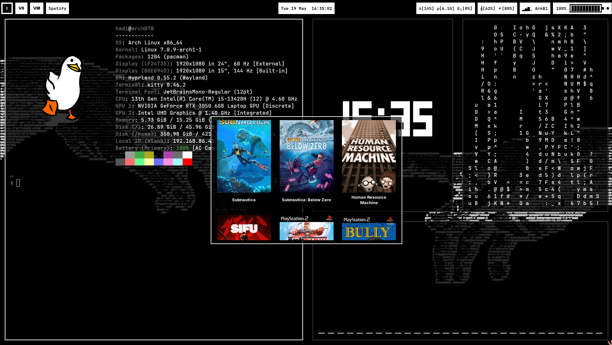

# hofi

A Wayland-native GTK overlay game launcher for Steam, Heroic/Epic, PCSX2, and custom games.

Displays as a fullscreen-capable cover-grid overlay (like rofi, but for games) using `gtk-layer-shell`. Covers are fetched from Steam CDN and optionally from [SteamGridDB](https://www.steamgriddb.com/).



## Features

- **Steam** — reads installed games from `.acf` manifests, fetches 600×900 portrait covers from Steam CDN or SteamGridDB
- **Heroic / Epic** — reads legendary's `installed.json` and metadata for proper titles and icons
- **PCSX2** — scans configured directories for ISO/BIN/IMG/etc. files and matches local cover art
- **Custom sources** — define your own directories, file extensions, and launch commands (e.g. Wine for Windows executables)
- **Custom entries** — pin a single app or launcher (e.g. TLauncher for Minecraft) with its own command and cover
- Cover art fallback chain: local cache → Steam CDN portrait → SteamGridDB → landscape CDN + blurred padding → theme icon
- Single-instance lock via `flock`
- Keyboard navigation: arrow keys to move, `Enter` to launch, `Escape` to close

## Requirements

- Python 3.11+
- GTK 3
- `gtk-layer-shell` (Wayland compositor with layer-shell support required)
- `python-dotenv`
- `pygobject`
- `Pillow` (optional — only needed for landscape-to-portrait cover padding)

On Arch Linux:

```bash
sudo pacman -S python-gobject gtk3 gtk-layer-shell python-dotenv python-pillow
```

## Installation

```bash
git clone https://github.com/your-username/hofi.git
cd hofi
cp .env.example .env   # add your SteamGridDB API key if you have one
python hofi.py
```

A `config.toml` is created automatically on first run with sensible defaults.

## Configuration

`config.toml` lives next to `hofi.py`. All paths support `~` expansion.

```toml
[display]
columns       = 3
window_width  = 600
window_height = 400
card_ratio    = 1.45   # height/width ratio of each cover card
spacing       = 10
padding       = 12
font_size     = 13
# window_x / window_y override centering (pixels from top-left of primary monitor)

[steam]
enabled   = true
steamapps = "~/.steam/steam/steamapps"

[heroic]
enabled       = true
legendary_dir = "~/.config/heroic/legendaryConfig/legendary"

[pcsx2]
enabled    = true
emulator   = "pcsx2-qt"
game_dirs  = ["~/Games", "~/PS2games"]
slow_boot  = false  # true → full BIOS boot (PS2 startup animation) before the game
extensions = ["iso", "bin", "img", "mdf", "nrg"]

[custom]
enabled = true

[[custom.sources]]
name       = "Windows games"
tag        = "WIN"
dirs       = ["~/pgames"]
extensions = ["exe", "sh"]
launch     = "wine {path}"

# Single apps/launchers that aren't a directory of game files
[[custom.entries]]
title  = "Minecraft"
tag    = "MC"
dir    = "/usr/games/tlauncher"          # optional working directory
launch = "/usr/games/tlauncher/lib/jvm/jre/bin/java -jar /usr/games/tlauncher/starter-core.jar"
cover  = "~/holder/Projects/hofi/assets/minecraft.png"   # path, or an icon-theme name
```

### SteamGridDB covers

Set your API key in `.env` (get one at <https://www.steamgriddb.com/profile/preferences/api>):

```
SGDB_KEY=your_key_here
```

## Keybindings

| Key | Action |
|-----|--------|
| Arrow keys | Navigate grid |
| `Enter` | Launch selected game |
| `Escape` | Close |
| Click | Select / double-click to launch |

## launcher.sh

The included `launcher.sh` cycles rofi → hofi → aofi → rofi — useful as a single hotkey or gesture binding:

- If rofi is open → close rofi and open hofi
- If hofi is open → close hofi and open [aofi](https://github.com/hadi-soubra/aofi) (anime launcher)
- If aofi is open → close aofi and open rofi
- Otherwise → open rofi

Bind it to a key in your compositor config.

## License

MIT
